# Issue #314: tool results announced from a region present before the action

- **Before**: exact base `origin/main` **fb45c3eb4e6e8351dfed673c00c730cbcdd91ef2**, in `before/`
- **After**: fix head **3de73f0ab0de8e09a0a3d9131b97f0577e13afb7** (branch `fix/314-tool-results-announced`), in `after/`
- Fixture backend only (`dist-fixture`, Playwright Chromium in the pinned Playwright docker image, viewport from playwright.config.ts, clock fixed at FIXTURE_NOW). Fixture testnet addresses only; no real seeds, keys or hosts.
- Each state was shot in light and dark. `1-empty` is the screen before the action (no result); `2-result` is after it.
- **Layout check**: every `before/X.png` is pixel-identical to `after/X.png` (PIL `ImageChops.difference(...).getbbox() is None` for all 28 pairs). The empty region takes no space, and the result shows exactly as before. What changes is not visible: on the fix head, the region is in the DOM, empty, before the action, and its role is fixed (see e2e/a11y-tool-results.spec.ts).
- `SHA256SUMS` lists every file.

## Tools ▸ Repair (`repair-outcome`, polite status)

scenario `tools-stuck-funding`; empty = tab opened; result = Finish transfers + fixture passphrase → “0 resumed, 0 completed, 0 still pending.”. Framing: Tools main pane.

| State | Theme | Before @ fb45c3eb4 | After @ 3de73f0ab |
|---|---|---|---|
| before the action (empty) | light | 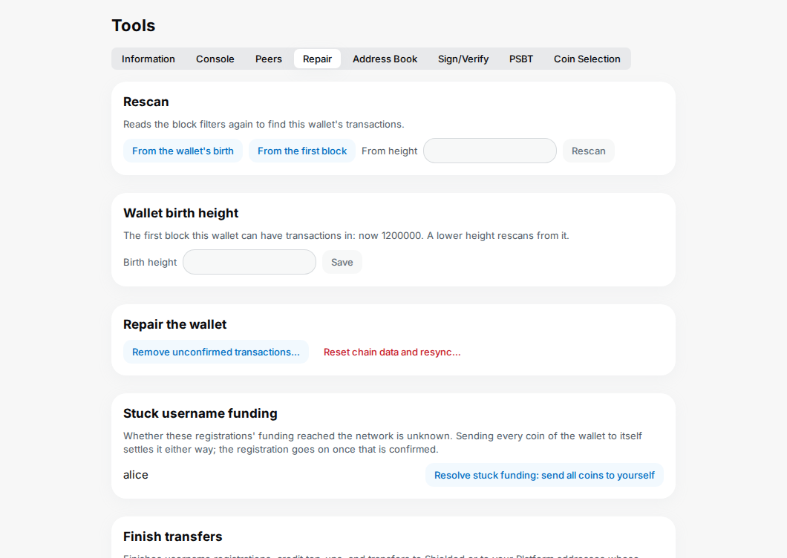 `before/repair-light-1-empty.png` |  `after/repair-light-1-empty.png` |
| before the action (empty) | dark |  `before/repair-dark-1-empty.png` | 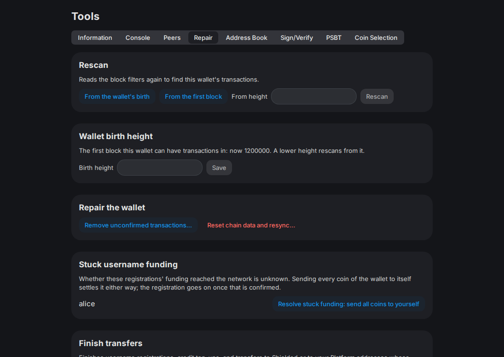 `after/repair-dark-1-empty.png` |
| after the action (result shown) | light |  `before/repair-light-2-result.png` | 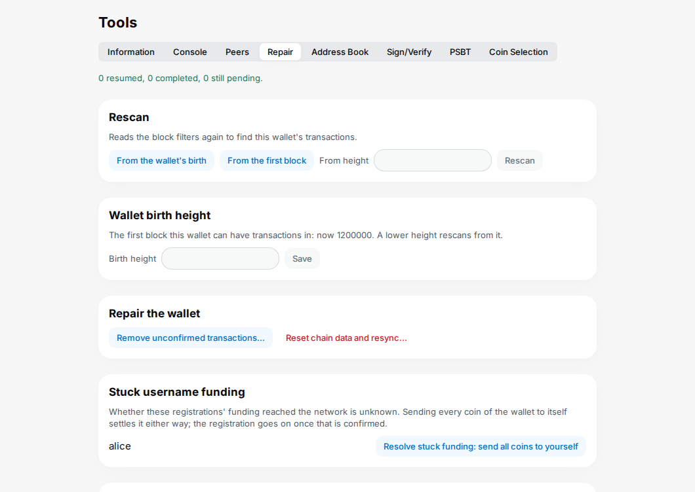 `after/repair-light-2-result.png` |
| after the action (result shown) | dark | 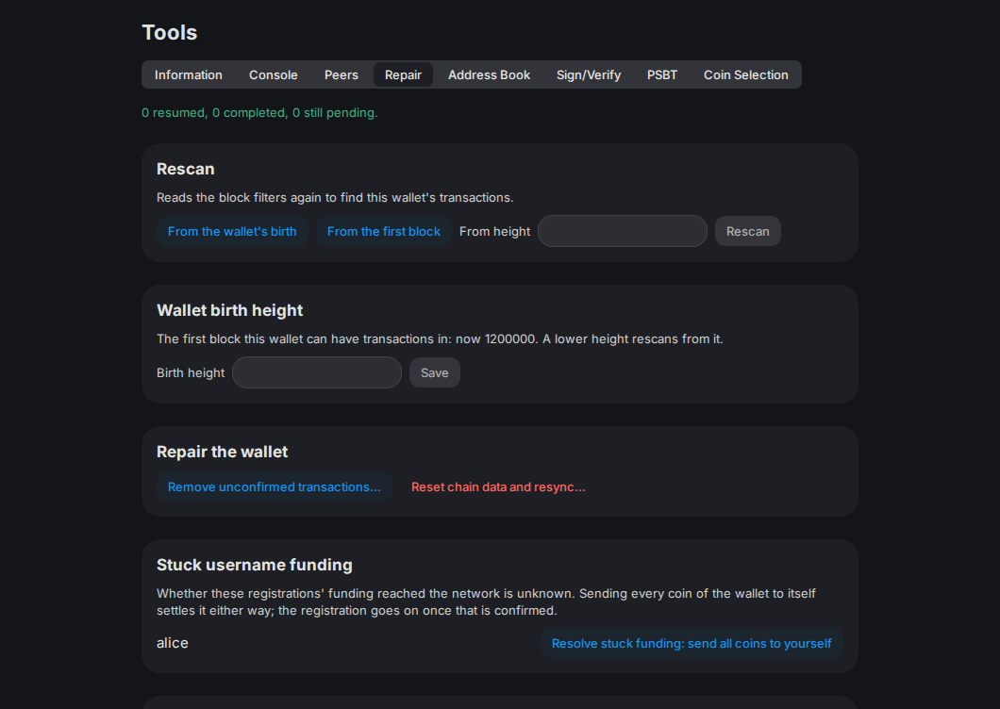 `before/repair-dark-2-result.png` |  `after/repair-dark-2-result.png` |

## Tools ▸ Sign/Verify ▸ Sign message (`sign-result`, polite status)

scenario `funded`; result = address “nonsense”, Sign Message → “The entered address is invalid. …”. Framing: Tools main pane.

| State | Theme | Before @ fb45c3eb4 | After @ 3de73f0ab |
|---|---|---|---|
| before the action (empty) | light |  `before/sign-light-1-empty.png` | 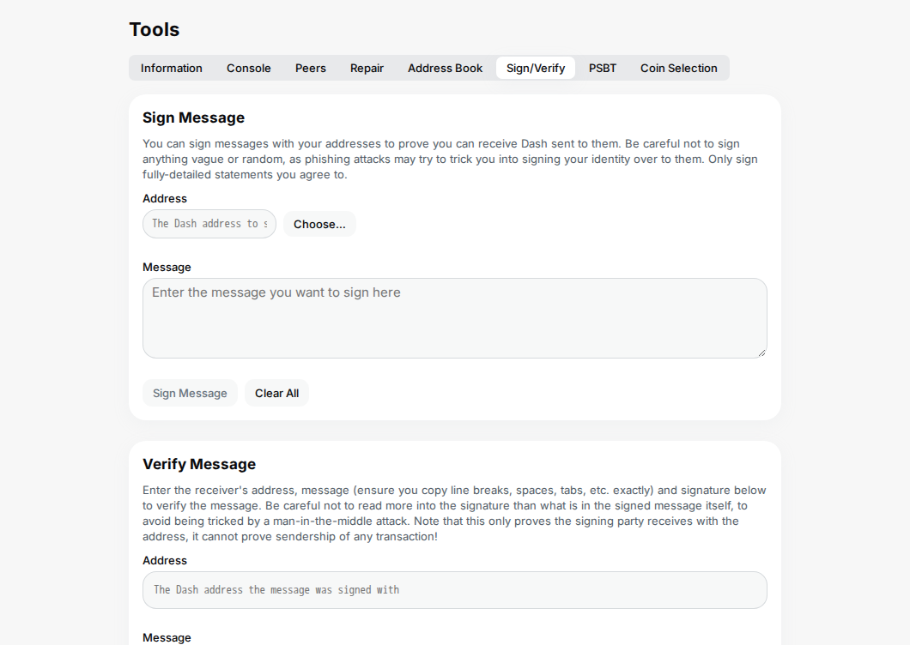 `after/sign-light-1-empty.png` |
| before the action (empty) | dark | 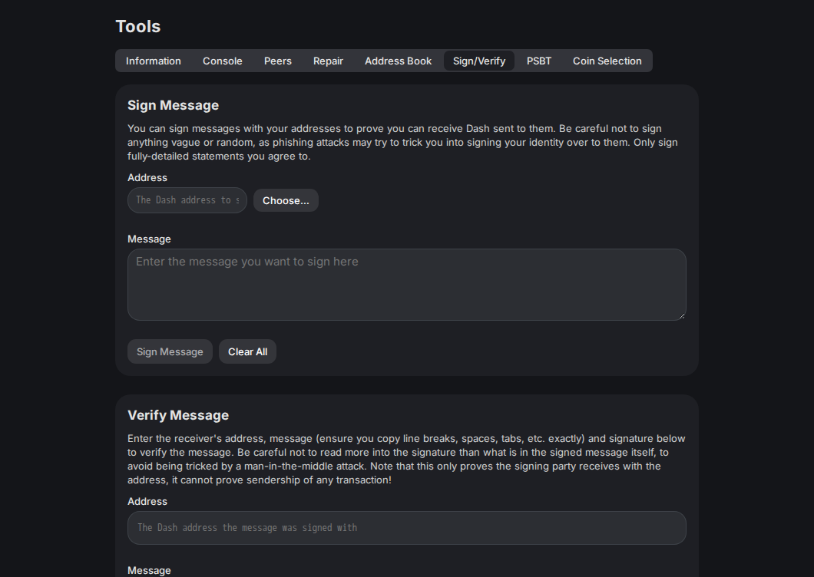 `before/sign-dark-1-empty.png` |  `after/sign-dark-1-empty.png` |
| after the action (result shown) | light |  `before/sign-light-2-result.png` | 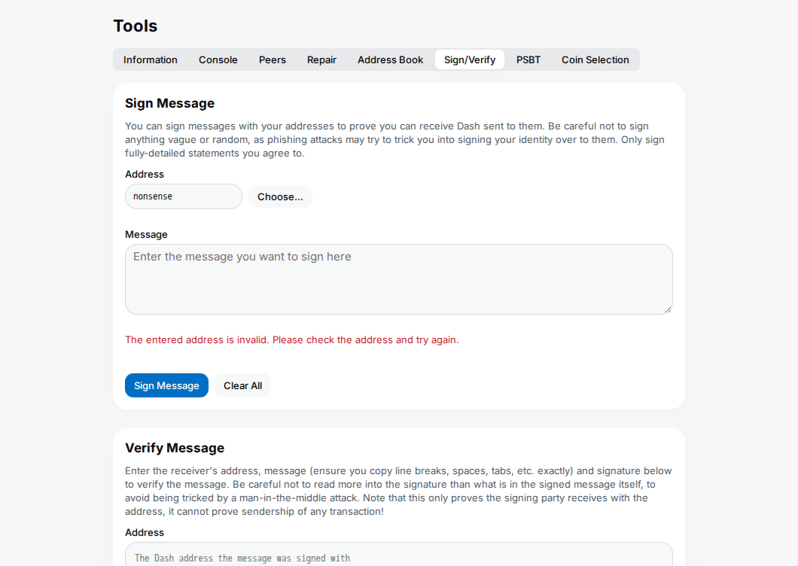 `after/sign-light-2-result.png` |
| after the action (result shown) | dark | 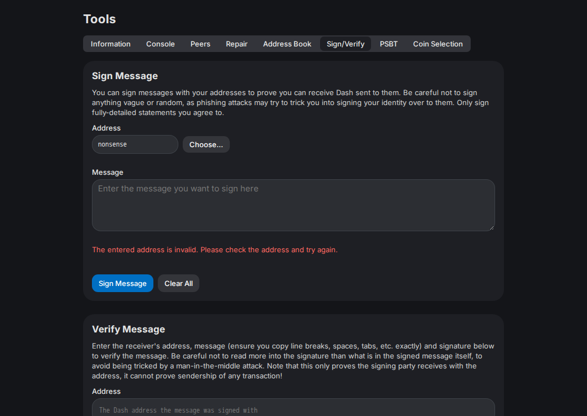 `before/sign-dark-2-result.png` |  `after/sign-dark-2-result.png` |

## Tools ▸ Sign/Verify ▸ Verify message (`verify-result`, polite status)

scenario `funded`; result = address and signature “nonsense”, Verify Message → “Invalid address: check it and try again.”. Framing: Verify card.

| State | Theme | Before @ fb45c3eb4 | After @ 3de73f0ab |
|---|---|---|---|
| before the action (empty) | light | 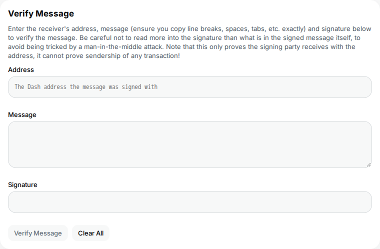 `before/verify-light-1-empty.png` |  `after/verify-light-1-empty.png` |
| before the action (empty) | dark |  `before/verify-dark-1-empty.png` | 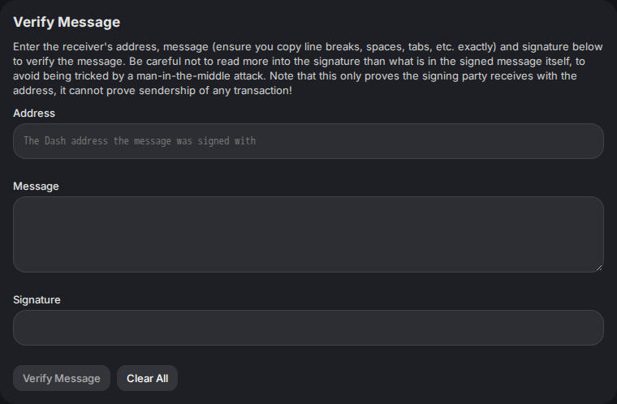 `after/verify-dark-1-empty.png` |
| after the action (result shown) | light |  `before/verify-light-2-result.png` | 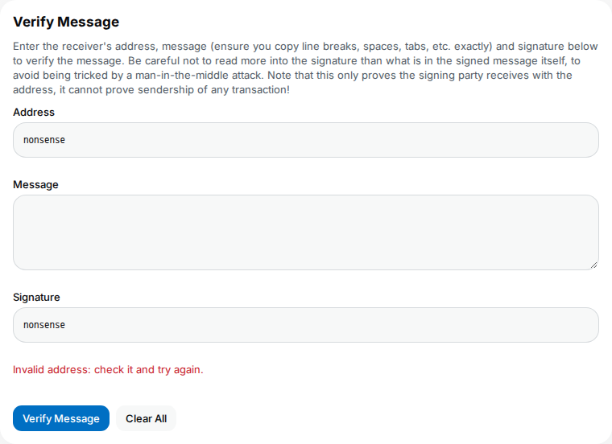 `after/verify-light-2-result.png` |
| after the action (result shown) | dark |  `before/verify-dark-2-result.png` | 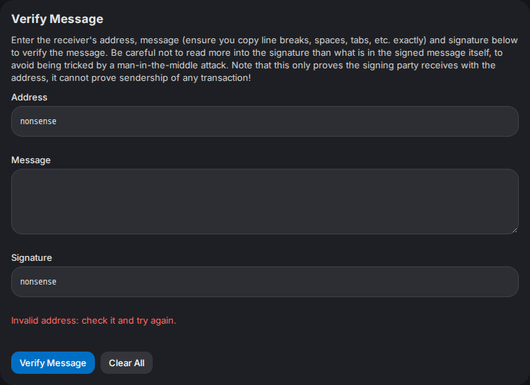 `after/verify-dark-2-result.png` |

## Tools ▸ Information ▸ DashPay card (`information-dashpay-outcome`, polite status)

scenario `dashpay-info-spv`; result = Sync now → “A DashPay pass was asked for. …”. Framing: DashPay card.

| State | Theme | Before @ fb45c3eb4 | After @ 3de73f0ab |
|---|---|---|---|
| before the action (empty) | light | 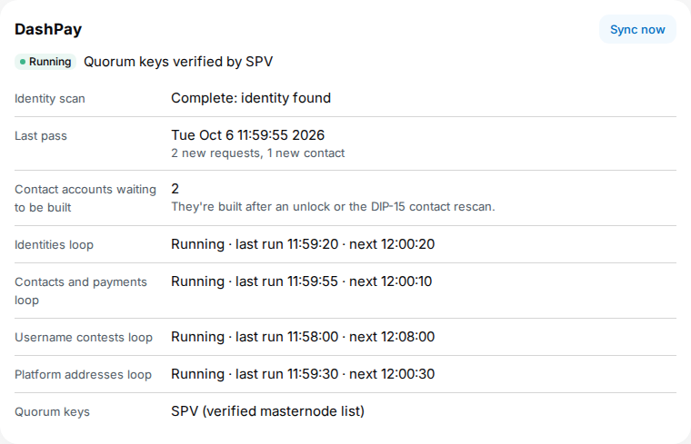 `before/dashpay-info-light-1-empty.png` |  `after/dashpay-info-light-1-empty.png` |
| before the action (empty) | dark | 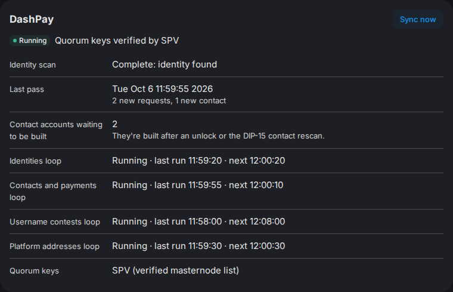 `before/dashpay-info-dark-1-empty.png` |  `after/dashpay-info-dark-1-empty.png` |
| after the action (result shown) | light |  `before/dashpay-info-light-2-result.png` | 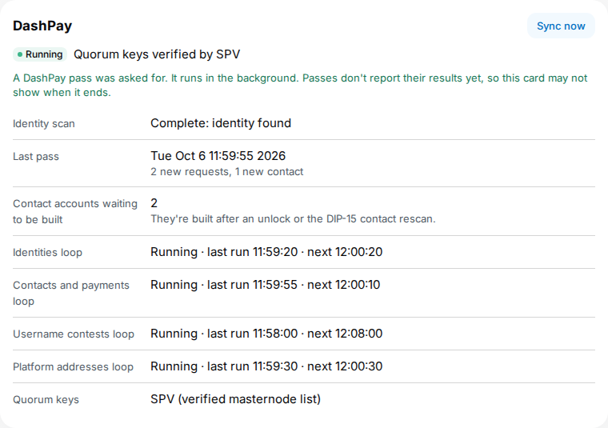 `after/dashpay-info-light-2-result.png` |
| after the action (result shown) | dark | 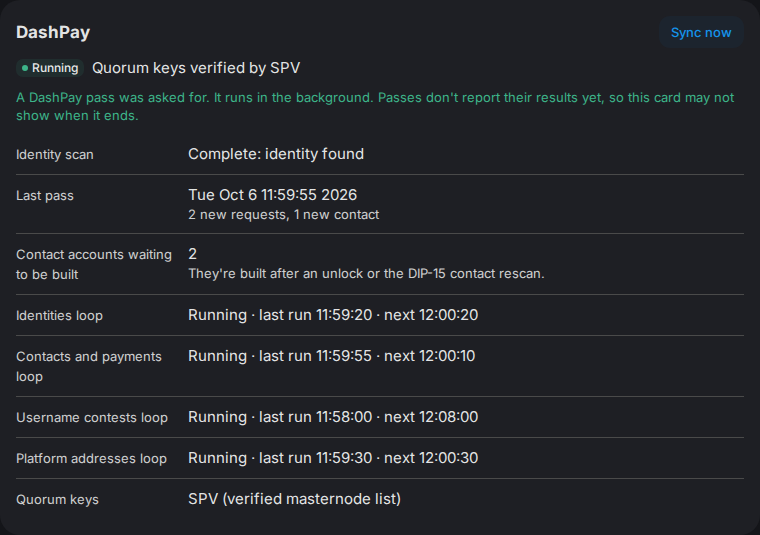 `before/dashpay-info-dark-2-result.png` |  `after/dashpay-info-dark-2-result.png` |

## Tools ▸ Address Book ▸ Export (`address-book-exported`, polite status)

scenario `funded`; result = Export… → “Exported to /home/user/Documents/Sending addresses.csv.” (fixture path). Framing: Tools main pane.

| State | Theme | Before @ fb45c3eb4 | After @ 3de73f0ab |
|---|---|---|---|
| before the action (empty) | light |  `before/address-book-export-light-1-empty.png` |  `after/address-book-export-light-1-empty.png` |
| before the action (empty) | dark |  `before/address-book-export-dark-1-empty.png` |  `after/address-book-export-dark-1-empty.png` |
| after the action (result shown) | light |  `before/address-book-export-light-2-result.png` | 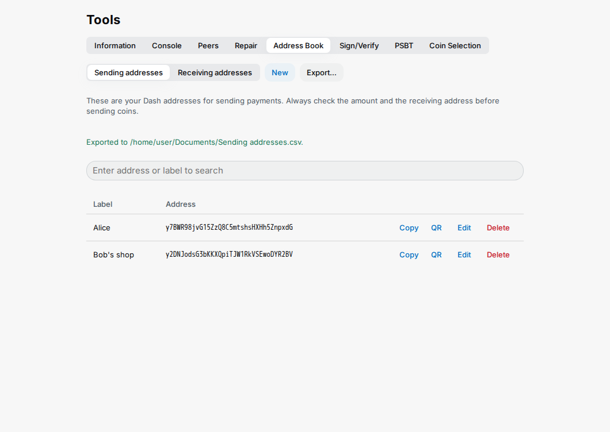 `after/address-book-export-light-2-result.png` |
| after the action (result shown) | dark | 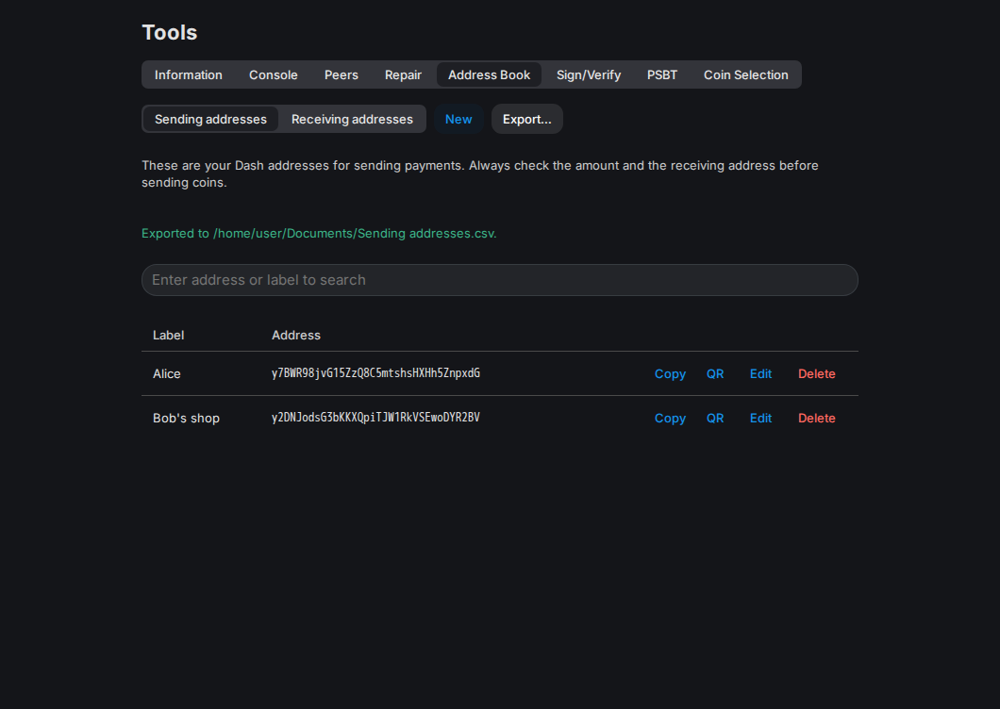 `before/address-book-export-dark-2-result.png` |  `after/address-book-export-dark-2-result.png` |

## Tools ▸ Address Book error (`address-book-problem`, alert)

scenario `funded`; result = fixture `address_book` set to fail, then Delete on the first entry; the reload fails → “Something went wrong (internal).”. Framing: Tools main pane.

| State | Theme | Before @ fb45c3eb4 | After @ 3de73f0ab |
|---|---|---|---|
| before the action (empty) | light |  `before/address-book-problem-light-1-empty.png` | 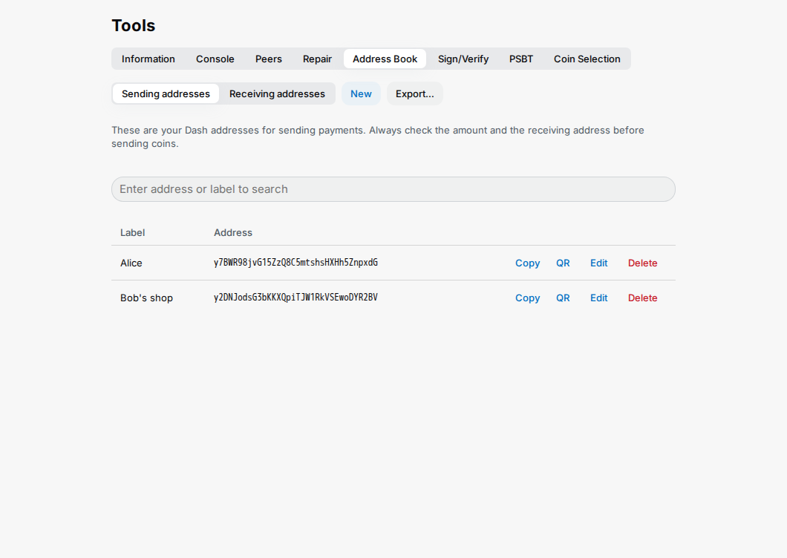 `after/address-book-problem-light-1-empty.png` |
| before the action (empty) | dark | 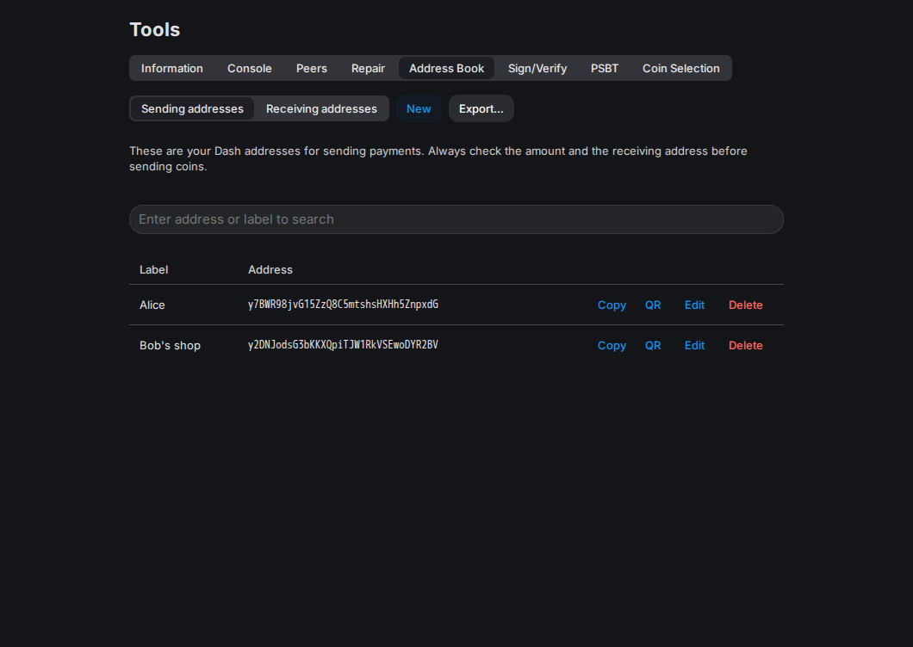 `before/address-book-problem-dark-1-empty.png` |  `after/address-book-problem-dark-1-empty.png` |
| after the action (result shown) | light |  `before/address-book-problem-light-2-result.png` | 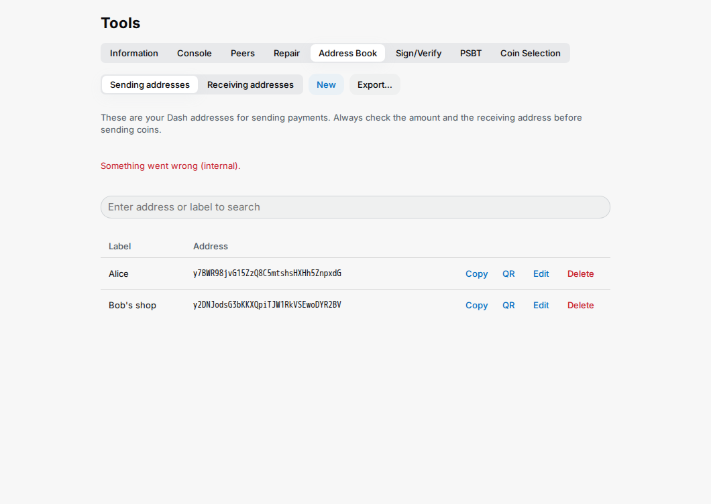 `after/address-book-problem-light-2-result.png` |
| after the action (result shown) | dark |  `before/address-book-problem-dark-2-result.png` | 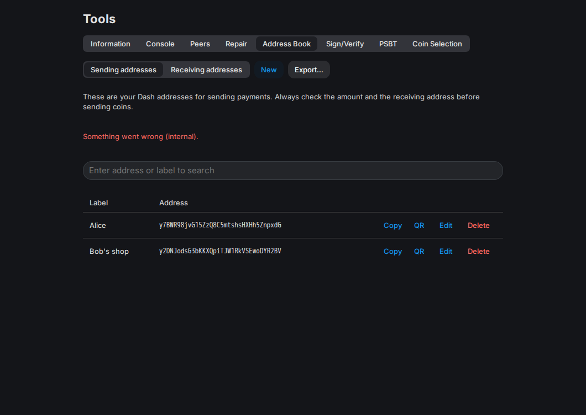 `after/address-book-problem-dark-2-result.png` |

## Pay ▸ To an address ▸ Address Book… picker error (`address-book-problem` in the sheet, alert)

scenario `funded`; empty = picker opened with a readable book; result = picker closed, fixture `address_book` set to fail, picker opened again → “Something went wrong (internal).”. Framing: full window.

| State | Theme | Before @ fb45c3eb4 | After @ 3de73f0ab |
|---|---|---|---|
| before the action (empty) | light |  `before/picker-problem-light-1-empty.png` | 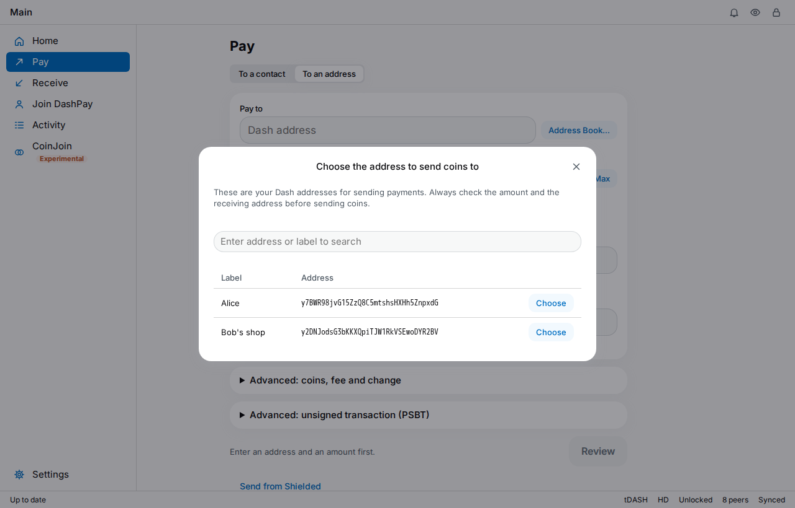 `after/picker-problem-light-1-empty.png` |
| before the action (empty) | dark | 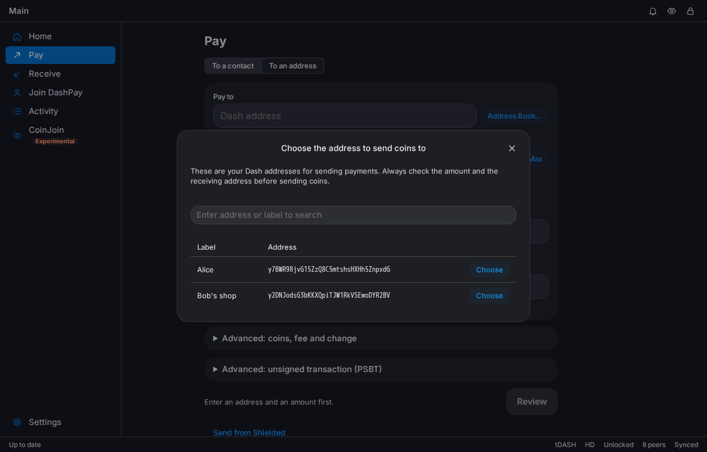 `before/picker-problem-dark-1-empty.png` |  `after/picker-problem-dark-1-empty.png` |
| after the action (result shown) | light |  `before/picker-problem-light-2-result.png` | 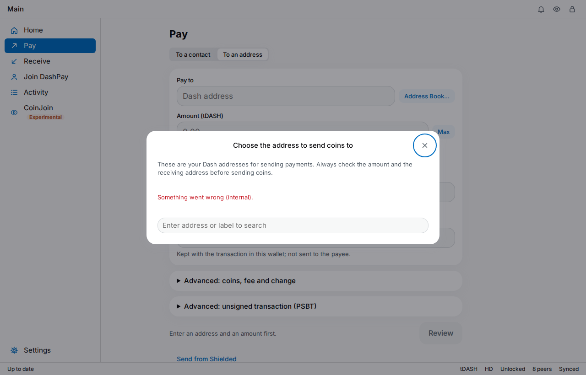 `after/picker-problem-light-2-result.png` |
| after the action (result shown) | dark | 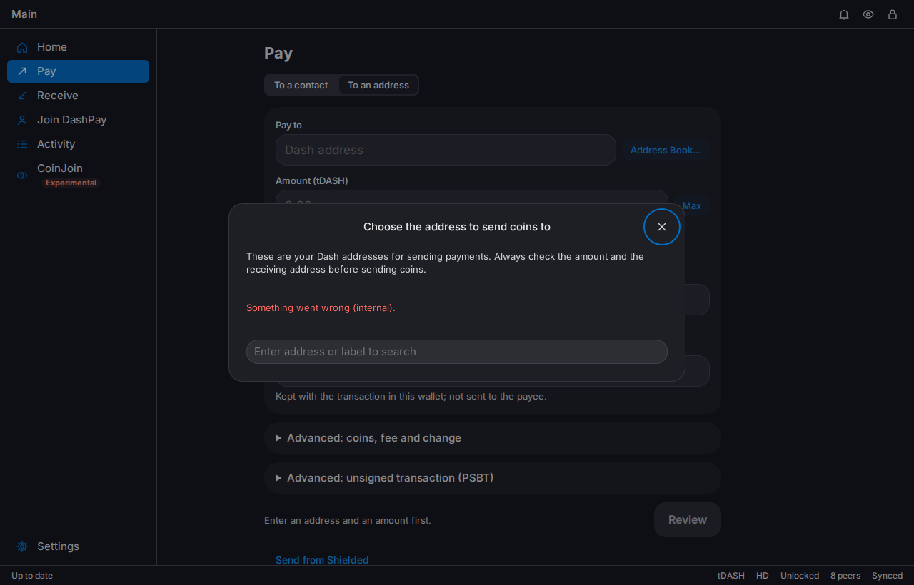 `before/picker-problem-dark-2-result.png` |  `after/picker-problem-dark-2-result.png` |

